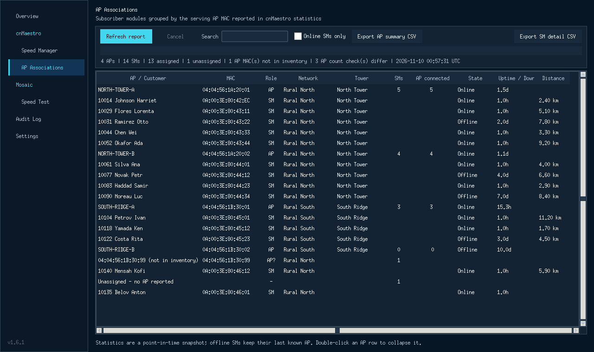

# Operations Toolkit 1.6.1

Operations Toolkit 1.6.1 is a local candidate that preserves the working cnMaestro Speed Manager and Mosaic Speed Test modules and adds an AP Association report built from cnMaestro statistics.

## What changed in 1.6.1

- Added **cnMaestro > AP Associations**: every PMP subscriber module is grouped under the AP MAC that cnMaestro statistics report as its serving AP.
- Reads the Statistics API (`/api/v2/devices/statistics`), the only cnMaestro endpoint that exposes `ap_mac`; the Devices inventory endpoint does not return it.
- Collects one paginated statistics pass and partitions AP and SM rows locally, so a full-network report needs no per-device requests.
- Fixes the statistics request for cnMaestro builds that reject `mode` with HTTP 400: the report no longer sends it, shows cnMaestro's own error text, and falls back to reading each SM's statistics individually if the bulk query is still refused. Fallback runs are labelled in the status line.
- Lists every AP even when it has no associated SMs, and keeps two explicit exception buckets: SMs with no reported AP ("Unassigned") and SMs whose AP MAC is not in the AP inventory.
- Cross-checks each AP's own `connected_sms` count against the number of online SMs in the report and marks differences, which exposes stale associations without hiding them.
- Exports two Excel-compatible CSVs: one row per AP with SM MACs and names joined in-cell for management review, and one row per SM for pivot tables and per-customer lookup. Both follow the current search/online filter and prefix formula-leading cells.
- Stamps every row with the UTC snapshot time. The report is a point-in-time read, not history.
- Runs collection off the Tk thread with progress, cancellation, and a clear failure message when cnMaestro rejects the request.
- Preserves the cnMaestro Speed Manager, Mosaic, audit, and credential behavior from previous releases.

## What changed in 1.5.0

- Added nested **Mosaic > Speed Test** in-app navigation using the existing dense dark workspace.
- Matches cnMaestro customers to Mosaic by an exact leading subscriber code; normalized customer names are confidence checks only. Missing, duplicate, and multi-device matches remain operator-review states.
- Search & add appends multiple subscribers into one selected bulk queue without replacing prior rows or results.
- Shows live per-customer stages and an overall progress bar while sequential tests run.
- Surfaces terminal Mosaic diagnostic errors as definite failures so retries unlock without mislabeling them as missing results.
- Offers manual retry for selected retryable failures and optional 1-3 automatic retries; unknown, ambiguous, locked, pending, and unsupported outcomes are never automatically retried. Each retry waits five seconds, creates a separate journal attempt, and repeats full eligibility preflight.
- Adds capability preflight and clearly marks unsupported routers such as SR905acv instead of offering a test action.
- Adds an in-app handoff after successful cnMaestro upgrades; it never starts tests automatically.
- Shows test date/time in UTC and supports clearing visible rows or exporting Excel-compatible CSV.
- Provides a structured pop-out Preview Changes table while keeping update checks in Settings.
- Runs explicitly selected supported Ookla tests sequentially, with a durable local journal and unknown-outcome reconciliation.
- Automatically cleans app-owned terminal pending flags and provides a guarded Clear stale request action for externally staged leftovers.
- Offers a confirmed local retry-lock release only after an old statusless operation has no remote pending action and no newer result.
- Mosaic passwords are optionally stored per Windows user in Windows Credential Manager, never plaintext, and never auto-connect.
- Preserves the cnMaestro API and guarded operational behavior from previous releases.

Older releases remain available in GitHub release history.

## Included v1.1.0 behavior

- Optional closest-downstream package suggestions with adjustable tolerance and visible DL/UL variance. Exact package remains authoritative.
- Sortable columns.
- Persistent checkbox selection across filters, with select/deselect visible and selected-only view.
- Publish progress bar, per-customer stage, success/failure counters, and completion popup.
- System, Light, and Dark appearance modes from the v1.1.0 baseline.

## Run from source

On Windows, run **Launch Operations Toolkit.bat**. Expand **cnMaestro** for Speed Manager and AP Associations, or **Mosaic** for Speed Test. Keep remote actions disabled during validation.

The pinned dependencies are listed in `requirements.txt`; `keyring` uses the current Windows user's Credential Manager on Windows.

## AP association report

Expand **cnMaestro > AP Associations**, connect from the Speed Manager page, then choose **Refresh report**. Double-click an AP row to collapse or expand it.

- **Export AP summary CSV** is the manager-facing view: one row per AP with network, tower, SM count, the AP's own connected count, and the SM MACs and names joined in single cells.
- **Export SM detail CSV** is the pivot-friendly view: one row per subscriber module with its AP MAC, AP name, state, status age, distance, and last sync time.

Both exports follow the current search and **Online SMs only** filter. Statistics are a point-in-time read: offline SMs keep the last AP they reported, so the report is the current association map rather than an association history. An AP whose `connected_sms` count disagrees with the online SM count is marked with `⚠`; that normally means the AP's view and the SM's last report have not converged yet. Only PMP SMs are included, matching the Speed Manager's package model.

If the report fails immediately, check that the API client can read `Statistics` data for the account; cnMaestro returns 401/403 for a client limited to Devices.

## Update checks

No sidecar file is required. The app checks the built-in Operations Toolkit `latest.json` manifest and, after confirmation, opens the approved release download in the browser. It does not replace or install the executable automatically.

To override the manifest URL, place a valid `update_config.json` beside the executable. See `update_config.example.json` for the optional format.

## Build the Windows executable

Run `build_windows.bat`, or use the equivalent command after installing `requirements.txt`:

```powershell
pyinstaller --noconfirm --clean --onefile --windowed --hidden-import keyring.backends.Windows --name "Operations-Toolkit-v1.6.1" cnmaestro_speed_manager.py
```

The executable is written to `dist\Operations-Toolkit-v1.6.1.exe`.

## Regression guard

`release_checks/ast_behavior_guard.py` compares the API class and nonvisual operational methods with the original v1.1.0 source by AST. The intentionally changed updater resolver/check path, credential/settings methods, and in-app visual navigation are covered by focused tests. CI also checks Python syntax/import, builds the Windows one-file/windowed executable, and launches and closes the GUI briefly with preview mode enabled and without making cnMaestro calls.

## Approved interface





## Approximate matching safety

Approximate matching changes display/grouping only. Preview retains actual live QoS. The downstream tolerance defaults to 10%. Upload variance is shown but does not determine the suggestion.
